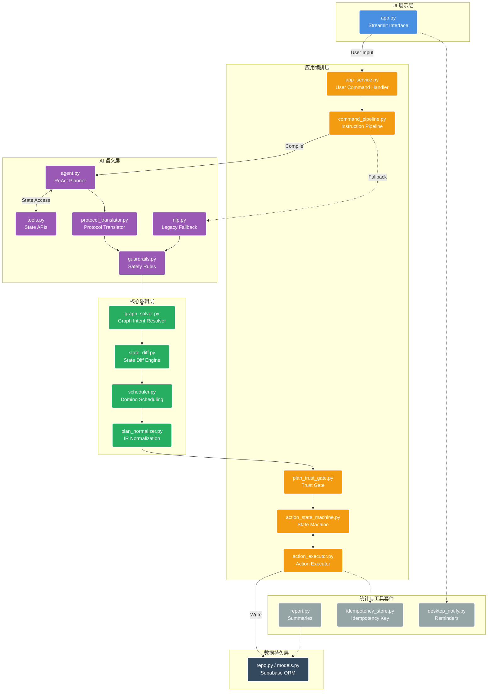

# 智能排程助手（AI-Powered Schedule Planner）

## 1. 项目概述
这是一个基于大语言模型（LLM）驱动的自然语言智能日程排程系统。用户可以通过日常语言（例如「明天下午 3 点开会」、「把那个会改到下周三」或「帮我排一下今天的待办」）与助手交互。系统依靠 AI 解析用户意图，配合内置的多米诺排程算法处理并管理日程，最终将所有信息可视化并持久化。该系统不仅能完成传统的日程管理操作，还结合了任务追踪、历史快照与自动报告生成，形成完整的 GTD（Getting Things Done）工作流闭环。

## 2. 核心亮点特性
1. **自然语言直接排程**：无需学习固定死板的命令格式，支持口语化交流（处理模糊指代与相对时间）。
2. **多米诺式智能防冲突**：插入或修改日程后，系统能自动向后推延解决时间段重叠问题。
3. **安全可撤销语义**：支持用户确认再落库，同时底层的 `snapshots` 机制支持一键回退任何错误排程。
4. **工作追踪与复盘**：自带任务一键计时功能，主界面提供活跃度矩阵（Activity Matrix，类 GitHub 热力图）与自动化的日报、周报、月报汇总。
5. **前瞻性 AI 工具集方案**：在底层架构中设计了向多 Agent 与 Tool Calling 体系发展的标准扩展协议。

---

## 3. 分层系统架构 (Layered Design)

系统采用了严谨的分层架构设计，各层职责分明互相解耦，具体如下：

### 3.1 UI 展示层 (UI Layer)
- **核心文件**：`app.py`
- **主要职责**：基于 Streamlit 构建交互界面。包含左右布局设计（左侧对话和控制台，右侧日程时间轴查看区）；实现了“活跃度矩阵”组件渲染；支持基于 URL 参数触发事件计时器（启动、暂停、结束）；运行定时的系统提醒。

### 3.2 应用编排层 (Application Orchestration Layer)
- **`service/app_service.py`**：处理用户指令 (`handle_user_command`) 和验证确认落地 (`apply_pending_plan`)，内置动作时间编译层（冲突重排 + 依赖时间下界收敛）以及快照/回滚机制。
- **`service/command_pipeline.py`**：统一指令编译管线，负责处理和整合 Agent 执行路径与降级容错路径，并配置安全护栏与标准化输出。
- **`service/action_state_machine.py`**：每个独立动作（Action）的状态机处理引擎，涵盖前置校验、执行、后置验证和失败自动回滚。
- **`service/action_executor.py`**：封装运行器，确保状态机能够在各个写分支内具备强一致性表现。
- **`service/plan_trust_gate.py`**：事前写拦截网关，验证事实一致性与低置信度防御。

### 3.3 AI 语义生成与解析层 (AI Layer)
- **`ai/agent.py`**：基于 ReAct 模式的 Tool-calling 规划器（Planner），集成错误输出修复、死循环防护以及大模型底座切换容灾能力。
- **`ai/protocol_translator.py`**：大模型协议转化层，在执行严格校验前，将不可预期的生成结果标准化。
- **`ai/tools.py`**：确定性的工具 API，暴露给 AI Planner 进行精准的任务信息处理与状态访问。
- **`ai/nlp.py`**：基于单次 LLM 解析返回 JSON 结果的传统实体提取模块（兜底/降级链路）。
- **`ai/guardrails.py` & `ai/guardrails_wrapper.py`**：后置固定校验规则、安全限制的确定性处理模块。

### 3.4 核心逻辑层 (Logic Layer)
- **`logic/graph_solver.py`**：将复杂的 `GraphIntent`（图意图）解析为机器可理解执行的线性顺序动作。
- **`logic/plan_normalizer.py`**：动作中间件（IR）规范化提取和合并防重处理。
- **`logic/scheduler.py`**：核心调度算法，包含任务时间的自动调整以及解决重叠的“多米诺顺延算法”。
- **`logic/state_diff.py`**：意图状态 vs 目标状态的比对引擎，以此来决定最佳变更路径。

### 3.5 数据持久化层 (Data Layer)
- **核心文件**：`db/repo.py`, `db/models.py`, `db/client.py`, `schema.sql`
- **主要职责**：基于 Supabase (PostgreSQL) 的底层持久化存储，封装针对各个数据表（`tasks`，`long_tasks`，`snapshots`，`summaries`，`reminders`）的增删改查操作以及类型化数据字典模型。

### 3.6 统计、报告与工具层 (Infra/Utility/Reports)
- **`report.py`**：聚合统计归档，负责生成自然语言的总结陈述（日/周/月报）。
- **提醒模块**（`utils/desktop_notify.py`, `utils/reminder_check.py`, `run_reminder_daemon.py`）：异步的检查及跨平台的底层通知提醒守护进程。
- **并发与幂等机制** (`utils/idempotency_store.py`)：防重放攻击与分布式操作幂等存储。
- **日志模块** (`utils/log_markers.py`, `utils/logging_setup.py`)：提供了系统的调用链路及标准化运行分析日志能力。

---

## 4. 运行时核心流程 (Runtime Flow)

1. **接收输入**：用户的自然语言输入由 `app_service.py` 里的 `handle_user_command` 接收。
2. **意图编译**：请求进入 `run_command_pipeline` 管线，利用 AI 层完成语言到编译指令 (`CommandIntent`) 的转换。
3. **推演路径**：提取其中的目标状态（如存在），借助 `compute_state_diff` 解析成确定性的底层系统动作。
4. **验证拦截**：交给信任网关 (`PlanTrustGate`) 检查协议数据是否可信及模型幻觉是否背离本地既定事实。
5. **动作编译**：在写入前将候选 `actions` 编译为可执行动作（补全/修正时间锚点、处理依赖顺序、冲突时段自动重排）。
6. **沙盒预演**：对编译后的动作做前置硬错误规避及冲突核验。
7. **分步执行**：进入统一动作执行器（Action Executor）：`validate -> write -> verify -> rollback(如果失败)`。
8. **一致性检查**：整个管线任务落盘后通过最终环节检查对象目标状态的达成度。
8. **快照存底**：若出现非预期行为或语义不一致，自动触发作用域快照的撤回并将失败总结传递给前端；否则下发确认预览供最终用户判定。

## 5. 一致性与安全保证 (Consistency & Safety Guarantees)
- **无状态 AI 编排**：AI 规划请求中不存在隐式跨轮对话的全局记忆，只提供必要上下文。
- **协议防篡改与安全**：Agent 输出在正式执行前必须历经 Normalizer（统一规范化器）降配洗库。
- **事实强一致性验证**：AI 编排的计划如果背离了系统当前提取到的物理事实（同一会话内的 Tool Facts），将在写入阶段直接被系统拉黑阻断。
- **底层事务语义化**：单步操作产生的中间隐藏状态要么全部提交，要么执行前完全撤销，无“伪脏数据（Partial State）”。
- **确认才落袋为安**：用户的任何实质变更要求必须精准击中预期的目标态，不可盲目“仅当写入成功即默认成功”。
- **天然幂等设计**：相同时间窗口 (TTL) 内触发的多次冗余写入请求可被平滑丢弃防御。
- **严格写入边界**：开启智能体调度模式（Agent Mode）时，传统解析后门会被硬性关闭拦截外部不安全降级写入。

## 6. 核心接口拓展点 (Key Extension Points)
1. 在 `ai/tools.py` 增加新工具签名与 API，并在对应 Schema 进行注册，即可快速升级 Agent 在业务环境中的认知能力。
2. 继承拓展 `logic/plan_normalizer.py` 及 `service/app_service.py` 的校验阶段，即可灵活引入新的日程管理任务概念。
3. 在 `config.py` 配置中替换基础层 LLM Provider 模型地址，代码能够直接无缝进行商业底层驱动迁移替换且保证执行范畴语义一致。
