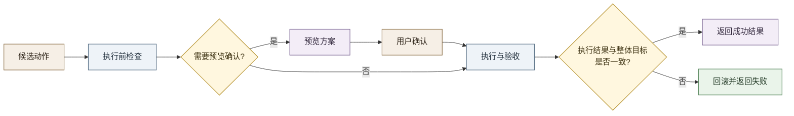
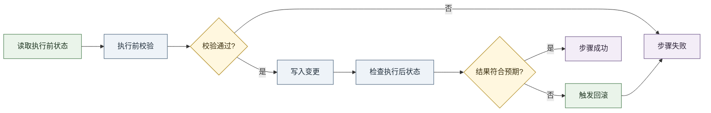

# 动作执行流程梳理

本文只说明“动作执行”本身，不展开前面的意图理解与规划细节。

这里关注三个核心问题：

1. 什么情况先给用户看预览，什么情况直接执行。
2. 真正执行前，系统如何做保护。
3. 执行失败时，系统如何保证状态可恢复。

## 执行主流程

## 图里每一步的含义

- 候选动作：前面的规划阶段已经整理出一组准备落地的操作。
- 执行前检查：先判断这组操作是否可信、是否有明确时间锚点、是否存在明显冲突、是否属于短时间重复请求。
- 是否需要确认：如果这次变更会影响多条任务，或者本质上属于“先规划再执行”的场景，就先进入预览。
- 预览方案：把“修改前”和“修改后”整理出来给用户看。
- 用户确认：用户决定是否真的落地这次变更。
- 执行与验收：这里合并表示真正落地前后的关键动作，包括保存快照、按顺序执行、逐步检查结果，以及最后确认整体目标是否成立。
- 回滚并返回失败：如果中途某一步失败，或者最后整体目标不成立，就回退到执行前的稳定状态。

## 流程图里的每一步是怎么做到的

### 1. 候选动作

- 上游先把用户需求整理成结构化动作。
- 这些动作里通常已经包含目标对象、预期时间、优先级或状态变化。
- 如果上游给的是“目标日程”，系统还会先把它转换成一组可执行动作。

### 2. 执行前检查

- 先检查这组动作是否足够可信，避免把低置信度方案直接写入。
- 再检查动作有没有足够明确的落地锚点，比如明确目标、明确时间、明确依赖关系。
- 对时间类动作，会先把时间补齐、归一到同一时间语义，并提前避开明显冲突。
- 还会拦截短时间内重复的等价请求，避免重复写入。

### 3. 是否需要预览确认

- 系统会看这次变更是不是会扩散到多条任务。
- 如果只是单点修改，通常可以直接执行。
- 如果会引起连锁调整，或者本质上是一次重排，就先进入预览。
- 这个判断由规则和当前任务状态共同决定，不靠临场生成。

### 4. 预览方案

- 系统会把受影响任务的“修改前”和“修改后”整理出来。
- 预览展示的不是自然语言猜测，而是基于当前状态推出来的实际差异。
- 预览阶段只暂存方案，不真正改动最终状态。

### 5. 用户确认

- 用户确认后，系统才会把预览方案当作正式执行输入。
- 执行前还会再次确认当前日程有没有变化，避免把旧预览写到新状态上。
- 同时也会再次检查是不是重复确认。

### 6. 执行与验收

- 真正写入前，系统会先保存受影响范围内的当前状态，作为回退依据。
- 然后按顺序逐步执行动作，而不是一次性整包提交。
- 每执行一步，都会重新读取执行后的状态，拿它和这一步的目标做对比。
- 这里判断的重点不是“是否调用成功”，而是“结果状态是否真的变成了期望状态”。
- 如果单步通过，系统继续下一步；全部步骤结束后，还会再检查整体目标是否成立。
- 如果发现是小范围、可确定修复的问题，系统会先尝试一次低风险补救，再重新验收。

### 7. 回滚并返回失败

- 如果某一步执行后结果不符合预期，或者最终整体目标仍然不成立，系统就停止继续执行。
- 然后用最开始保存的状态快照，把受影响范围恢复回去。
- 最终返回失败信息，而不是留下“执行了一半”的中间态。

## 每一步是谁在做

这张图里，真正进入“执行层”之后，基本已经不是 LLM 在主导，而是代码在主导。

可按下面理解：

- 候选动作：主要来自上游规划结果。
  - LLM 负责提出候选方案。
  - 代码负责把方案整理成系统能执行的结构。
- 执行前检查：代码层。
  - 这一层负责做确定性校验，不依赖 LLM 临场判断。
- 是否需要确认：代码层。
  - 由系统根据影响范围和风险决定，不交给 LLM 临时拍板。
- 预览方案：代码层。
  - 代码把变更前后整理成可展示内容。
- 用户确认：用户。
- 执行与验收：代码层。
  - 这里包含保存快照、顺序执行、步骤验收和整体验收。
- 回滚并返回失败：代码层。

## LLM 在这张图里的位置

如果只从职责划分来看：

- LLM 更像“上游规划者”，负责产出候选动作或候选目标。
- 代码层更像“执行控制器”，负责决定能不能执行、要不要确认、怎么执行、是否成功、失败后怎么恢复。

所以这部分流程的重点是：

不是 LLM 直接执行动作，而是 LLM 提方案，代码决定是否落地并对结果负责。

## 单步执行的最小流程

## 这套执行设计抓住了什么重点

- 不是“拿到动作就直接写库”，而是先判断这次变更值不值得直接执行。
- 不是“写成功就算成功”，而是写完后还要验证结果。
- 不是“某一步失败只报错”，而是尽量恢复到之前稳定状态。
- 不是“局部步骤都成功就结束”，而是最后还要确认整体目标真的达成。

## 一句话概括

动作执行层本质上是一个：

“先检查、再预览或执行、逐步验收、失败可恢复”的落地流程。
