# Agent 端到端流程架构

本文只梳理当前代码里实际生效的 Agent 主流程：从用户输入，到生成结构化意图、进入预览或执行、完成验收与回滚。

不展开 `ai/nlp.py` 的传统解析方案；它在系统中仍是 fallback，但不属于本文主线。

## 高层架构图

```mermaid
flowchart LR
    U["用户输入"] --> UI["UI<br/>app.py"]
    UI --> AS["应用服务<br/>handle_user_command"]
    AS --> CP["命令编译流水线<br/>run_command_pipeline"]
    CP --> LLM["LLM Agent<br/>run_agent"]
    LLM --> TOOLS["工具层<br/>ai/tools.py"]
    TOOLS --> DB[("任务数据/快照<br/>db/repo.py")]
    LLM --> GI["GraphIntent"]
    GI --> GS["图求解器<br/>resolve_graph_intent"]
    GS --> CI["CommandIntent"]
    CI --> GATE["门禁与编译<br/>trust gate / normalize / prevalidate"]
    GATE --> DECISION{"是否需要确认?"}
    DECISION -->|是| PREVIEW["PendingPlan 预览"]
    PREVIEW --> CONFIRM["用户确认"]
    CONFIRM --> APPLY["apply_pending_plan"]
    DECISION -->|否| EXEC["ActionExecutor"]
    APPLY --> EXEC
    EXEC --> SM["单步状态机<br/>pre-validate -> write -> post-verify"]
    SM --> DB
    SM --> RESULT["结果 / 回滚 / 验收完成"]
```

## 主链路

1. 用户在 `app.py` 的 `st.chat_input(...)` 输入指令。
2. UI 调用 `service/app_service.py` 中的 `handle_user_command(...)`，这是 Agent 主流程入口。
3. `handle_user_command(...)` 拉取当天任务快照后，调用 `service/command_pipeline.py` 的 `run_command_pipeline(...)`。
4. `run_command_pipeline(...)` 在 Agent 模式下调用 `ai/agent.py` 的 `run_agent(...)`，让 LLM 以 tool-calling 方式生成结构化计划。
5. LLM 在生成最终结果前，可通过 `ai/tools.py` 查询任务、解析时间、检查冲突、验证候选计划；工具层再通过 `db/repo.py` 读取数据。
6. Agent 最终输出先经过协议归一与结构校验，形成 `GraphIntent`。
7. `logic/graph_solver.py` 的 `resolve_graph_intent(...)` 将 `GraphIntent` 解析为线性的 `CommandIntent`：
   负责真实任务绑定、时间锚定、依赖展开和 action 生成。
8. `handle_user_command(...)` 对 `CommandIntent` 继续做系统侧处理：
   `apply_guardrails(...)`、`normalize_command_intent(...)`、`evaluate_plan_trust(...)`、动作编译、动作预校验。
9. 之后进入两条落地路径：
   - 需要确认：组装 `PendingPlan`，返回给前端做预览。
   - 无需确认：直接进入执行器落库。
10. 执行完成后，系统做后验校验；必要时自动修复或回滚，并把最终结果返回 UI。

## Agent 内部流程

`run_agent(...)` 的职责不是直接产出可执行数据库写入，而是先产出图式意图。

内部可抽象为四步：

1. 组装系统提示与当前用户输入。
2. 让 LLM 在多轮对话中按需调用工具，收集任务事实、时间锚点和冲突信息。
3. 对最终输出做协议归一与 JSON/Schema 校验，得到 `GraphIntent`。
4. 对写操作候选计划可再经过一次计划审查，然后再交给图求解器。

这里 LLM 只负责“理解与规划”。
真正的任务绑定、执行约束和落库控制仍在系统侧。

## 中间表示与边界对象

### `GraphIntent`

- 所在位置：`ai/graph_models.py`
- 作用：LLM 输出的图式协议。
- 特征：保留节点、依赖、时间约束、推理说明，但还不是最终执行动作。

### `CommandIntent`

- 所在位置：`ai/models.py`
- 作用：系统统一执行 IR。
- 特征：面向执行层，包含 `intent`、`actions`、回复文本、澄清状态等。

### `PendingPlan`

- 所在位置：`service/app_service.py`
- 作用：预览确认阶段的暂存对象。
- 特征：承载预览更新列表、结构化 actions、作用域状态版本、目标态信息。

### `ActionExecutor` / `run_action_step`

- 所在位置：`service/action_executor.py`、`service/action_state_machine.py`
- 作用：统一执行器与单步状态机。
- 特征：把所有写操作收敛到一致的执行语义：
  `pre-validate -> write -> post-verify -> rollback(optional)`。

## 两条落地路径

### 1. 预览确认路径

以下情况通常先走预览，再等待用户确认：

- `plan` / `replan_all`
- 多任务冲突调整
- 一次 update 触发多条任务顺延

流程如下：

1. `handle_user_command(...)` 汇总待变更任务。
2. 组装 `PendingPlan` 返回给 `app.py`。
3. 前端展示“修改前 -> 修改后”的预览。
4. 用户点击确认后，`app.py` 调用 `apply_pending_plan(plan)`。
5. `apply_pending_plan(...)` 做状态版本校验、快照、顺序执行、后验校验与回滚控制。

### 2. 直接执行路径

以下情况通常不需要确认：

- 单步新增
- 单步删除
- 明确目标的单步完成
- 不会引起额外排程扩散的单步修改

流程如下：

1. `handle_user_command(...)` 直接构造待执行 action。
2. action 进入 `ActionExecutor.execute(...)`。
3. `run_action_step(...)` 执行单步状态机。
4. 成功则返回结果；失败则按快照回滚。

## 关键安全门

系统里真正控制“能不能写”和“写完算不算成功”的，不是 LLM，而是这些门禁：

- 协议失败拦截：若未得到可验证的结构化结果，停止写入。
- `AGENT_ONLY_WRITE_MODE`：启用后，只允许 Agent 成功产出的结构化结果写库。
- `evaluate_plan_trust(...)`：拦截事实冲突、低信号修复结果、未解析依赖等高风险计划。
- 动作预校验：先挡住非法 action、缺字段、时间不合法、明显冲突。
- 幂等指纹：拦截短时间重复等价写入。
- scope snapshot：写入前保存作用域快照，供失败时恢复。
- post-verify + repair：单步写入后做效果验收，必要时自动补救。
- desired state reconcile：对目标态做闭环核验，失败时回滚。

## 核心接口语义

### `handle_user_command(user_text, conversation_history)`

- 位置：`service/app_service.py`
- 返回值：`(reply_text, overflow_warning, pending_plan, reasoning)`
- 关键语义：
  - `reply_text`：给前端展示的主回复。
  - `overflow_warning`：排程越界等警告。
  - `pending_plan`：若不为 `None`，表示当前进入确认制流程。
  - `reasoning`：LLM 或编译链的推理摘要。

### `apply_pending_plan(plan)`

- 位置：`service/app_service.py`
- 作用：把预览计划真正写回数据库。
- 关键职责：
  - 从 `plan.actions` 或 `plan.updates` 还原执行动作
  - 校验 `state_version`
  - 保存快照
  - 顺序执行 actions
  - 做后验校验、自动修复、必要时回滚

### `GraphIntent -> CommandIntent`

- `GraphIntent` 负责表达：
  用户意图、任务节点、节点依赖、时间约束。
- `resolve_graph_intent(...)` 负责补足：
  真实任务 ID、开始结束时间、拓扑顺序、线性 action 列表。

也就是说：

- LLM 负责“理解用户想做什么”。
- `graph_solver` 负责“把图变成系统能执行的动作”。

## 模块职责表

| 模块 | 角色 |
| --- | --- |
| `app.py` | 接收用户输入、展示预览、触发确认执行 |
| `service/app_service.py` | 主编排层，衔接编译、门禁、预览、执行、验收 |
| `service/command_pipeline.py` | 统一命令编译流水线，组织 Agent 路径 |
| `ai/agent.py` | LLM tool-calling planner，产出 `GraphIntent` |
| `ai/tools.py` | 给 LLM 使用的确定性工具接口 |
| `logic/graph_solver.py` | 将图式意图展开为线性 `CommandIntent` |
| `service/plan_trust_gate.py` | 写入前可信度门禁 |
| `service/action_executor.py` | 统一动作执行器 |
| `service/action_state_machine.py` | 单步执行状态机与后验回滚语义 |
| `db/repo.py` | 任务、快照等持久化读写 |

## 不在本文展开的内容

- `ai/nlp.py` 的传统单次解析流程
- `ai/graph_agent.py`，当前主链路未引用
- 具体底层模型提供方、模型名称、SDK 细节

本文只描述当前代码中实际运行的 Agent 主路径。
