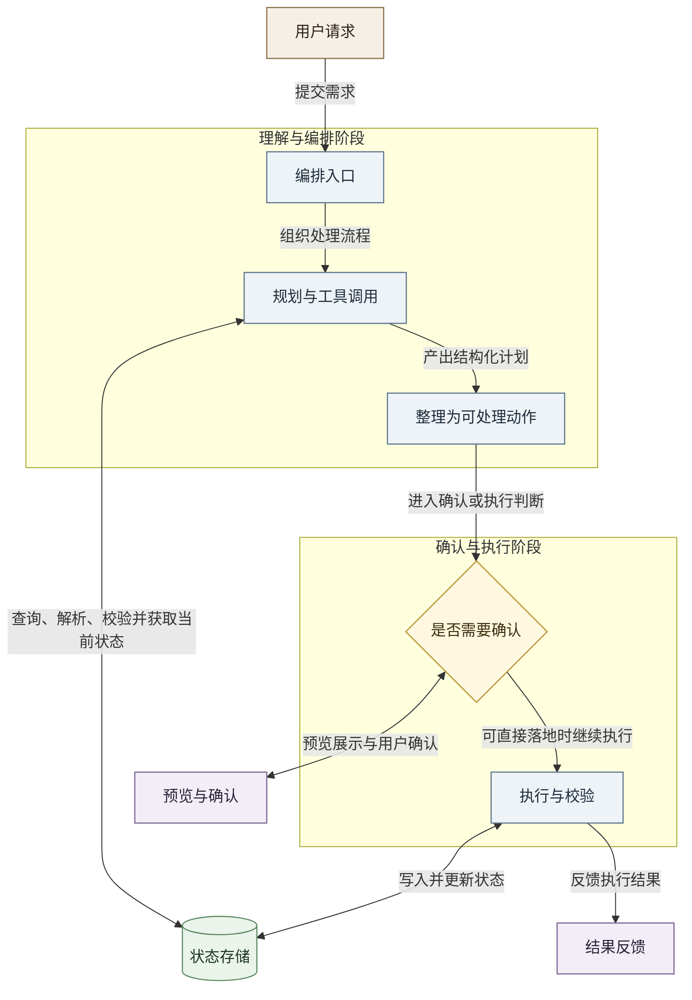

# Agent 运行示意图

这张图用较抽象的方式展示完整运行 flow，强调两个阶段：

- 上半部分是理解与编排。
- 下半部分是确认、执行与状态落地。

## 图的阅读方式

- 从上到下看：先理解请求，再决定如何执行。
- 左到右看：每条箭头都表示一次明确的流转关系。
- 中间的判断节点表示系统会在这里分成两种路径：
  - 先进入“预览与确认”。
  - 直接进入执行。

## 为什么不是“规划与查询”

这里不只是查询。

规划阶段除了读取当前任务状态，还会调用多种确定性能力，例如：

- 查询已有任务
- 解析自然语言时间
- 搜索空闲时段
- 检查时间冲突
- 校验候选计划

因此用“规划与工具调用”比“规划与查询”更准确。
