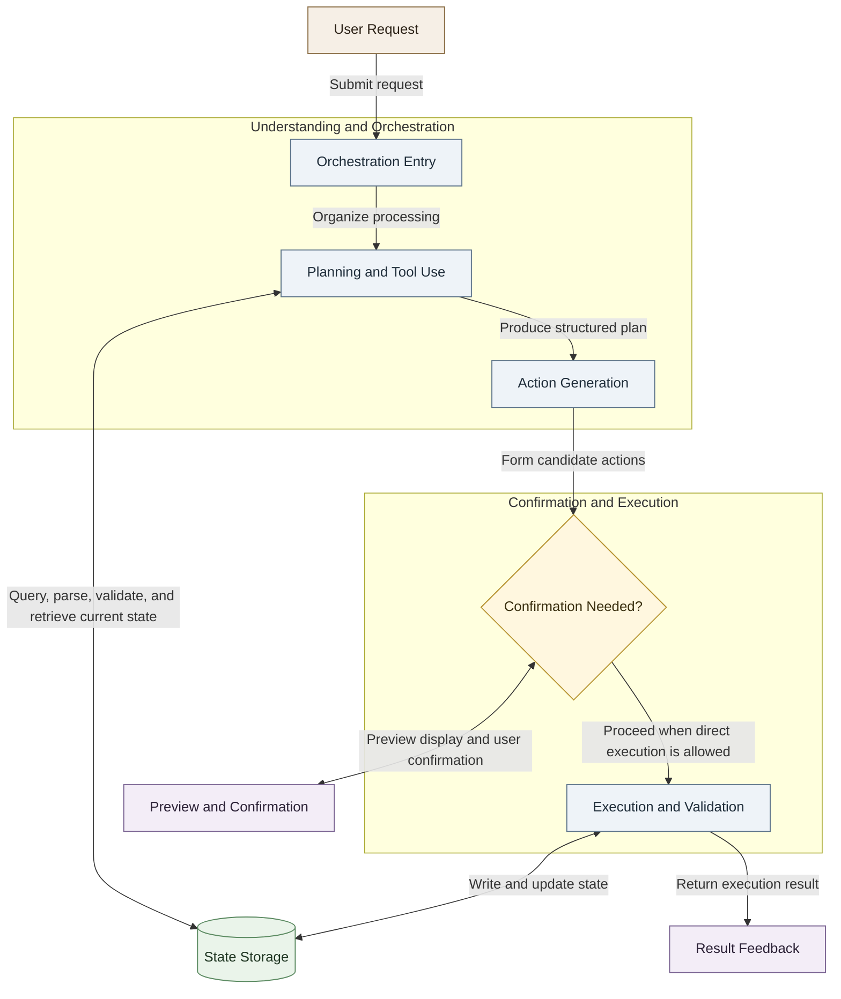

# Agent Runtime Diagram

This figure presents the runtime flow in an abstract way and highlights two stages:

- The upper part is for understanding and orchestration.
- The lower part is for confirmation, execution, and state persistence.

## How to Read the Figure

- Read from top to bottom: the system first understands the request, then decides how to execute it.
- Read each arrow as one explicit interaction or transition.
- The decision node in the middle splits the flow into two paths:
  - go to preview and confirmation first
  - or proceed directly to execution

## Why It Is Not Just "Planning and Querying"

This stage does more than querying.

During planning, the system can also invoke deterministic capabilities such as:

- task lookup
- natural language time parsing
- free-slot search
- conflict checking
- candidate-plan validation

So "Planning and Tool Use" is more accurate than "Planning and Querying".
