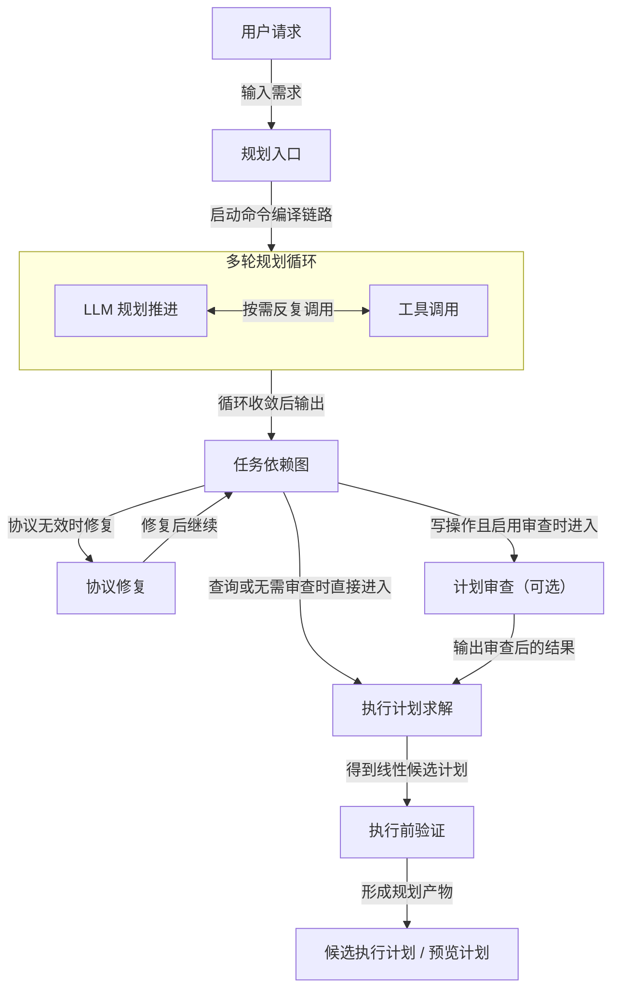

# 规划部分梳理

这份文档只聚焦【规划】本身，不展开真正的写库执行、后验修复和回滚。

这里的重点不是“一次 LLM 输出”，而是一个分层的规划过程：

1. 多轮调用工具收集事实
2. 生成任务依赖图
3. 对结果做协议修复与计划审查
4. 将审查后的结果交给执行计划求解
5. 在真正执行前完成执行前验证

## 先说结论

代码里的规划部分，本质上是一个“多轮工具调用的规划循环 + 多层校验收敛”的过程。

它不是简单的：

- 用户说一句话
- 模型吐出一个答案
- 系统直接执行

而更接近：

- 模型先反复查事实、解析时间、检查冲突、验证候选计划
- 然后输出一份任务依赖图
- 如果这个输出格式不稳定，系统会先修复
- 如果是写操作，系统还会再审一遍这个计划
- 最后才把规划结果转换成候选执行计划，并继续做执行前规则校验

## 规划主流程

## 流程图里每一步是谁做的

- 用户请求：用户输入，不属于系统内部处理。
- 规划入口：系统编排代码负责启动规划链路。
- 多轮规划循环：由 LLM 主导推进，但循环控制和消息回填由系统代码负责。
- LLM 规划推进：LLM 负责，根据上下文决定下一步是继续推理还是请求调用工具。
- 工具调用：工具代码负责执行，包括查询、时间解析、冲突检查、候选计划校验等。
- 任务依赖图：由 LLM 输出，系统代码负责解析和接收。
- 协议修复：仅在最终输出无法被系统正常解析时触发，由系统代码主导，必要时再借助专门模型修复格式。
- 计划审查（可选）：仅在写操作且启用审查时触发，由 LLM 侧审查器完成，系统代码负责触发和接收结果。
- 执行计划求解：系统代码负责，把任务依赖图转换成线性候选执行计划。
- 执行前验证：系统代码负责，包括归一化、可信度检查、动作编译和预校验。
- 候选执行计划 / 预览计划：系统代码负责形成，作为规划阶段的最终产物。

## 第一层：多轮规划循环

最核心的点在这里。

规划器不是只调用一次模型，而是在一个循环里不断尝试：

1. 让模型先给出下一步规划
2. 如果模型要求调用工具，就执行工具
3. 把工具结果回填给模型
4. 再让模型继续规划
5. 直到模型给出最终结构化结果，或达到轮次上限

这个循环在代码里是明确存在的：

- 有 `max_rounds`
- 每一轮都可能出现 `tool_calls`
- 工具结果会被重新塞回消息上下文
- 如果连续重复调用同类工具，还会触发停滞保护，强制要求模型停止继续查、直接输出最终 JSON

所以，规划部分的核心不是“生成文本”，而是“在循环中逐步收集信息并收敛到结构化计划”。

## 第二层：工具调用到底做什么

规划器能调用的工具不只是查询。

当前工具层里，至少包含这些规划能力：

- 查询某一天的任务
- 按关键词搜索任务
- 按任务标识获取任务详情
- 解析自然语言时间
- 搜索空闲时段
- 检查候选时间是否冲突
- 校验候选计划是否合法

也就是说，模型在规划过程中会不断做下面这些动作：

- 先查当前有哪些任务
- 再确认目标任务到底是哪一个
- 再解析“晚上八点”“明天下午”这类时间
- 再看这个时段是否空闲
- 甚至先把自己构造的候选动作交给 `validate_plan(...)` 做一次硬规则校验

因此，规划过程更准确地说是：

【推理 + 工具使用 + 结果回填】的循环。

## 第三层：任务依赖图

当规划器认为信息足够后，它不会直接输出数据库动作，而是输出一份任务依赖图。

这个结果的重点是：

- 表达用户意图
- 表达任务节点
- 表达节点间依赖
- 表达时间约束

它更像“规划草图”或“任务图”，而不是最终执行脚本。

这一步之所以重要，是因为复杂请求往往不是一个动作，而是一组前后相关的动作。

## 第四层：输出修复

规划器给出的最终输出，不一定每次都完全满足协议格式。

所以系统在这里还放了一层修复逻辑：

- 先尝试把模型输出解析成任务依赖图
- 如果最终输出不是合法 JSON，或字段不完整
- 系统会调用一个专门的“协议编译器”去把坏输出重新编译成合法结构
- 如果还不行，再要求模型重新只输出合法 JSON

这一层解决的是“模型输出格式是否稳定”的问题。

所以规划部分不只是“生成计划”，还负责把计划修成系统可接收的协议结果。

## 第五层：计划审查（可选）

如果当前规划结果是写操作候选计划，且启用了计划审查，系统会再加一层审查。

这一步不是执行，而是二次检查规划本身是否满足用户需求、是否合理。

它的作用是：

- 审查候选任务依赖图
- 必要时直接修正这个规划
- 输出修正后的任务依赖图

也就是说，系统里实际上存在两个模型侧环节：

1. 规划器：先生成候选规划
2. 审查器：再复核和修正候选规划

这一点正是当前文档里之前没有抓到的重点。

## 第六层：执行计划求解

进入执行计划求解有两条路径：

- 查询类结果或未启用审查的结果：任务依赖图直接进入执行计划求解
- 写操作且启用审查的结果：先经过计划审查，再进入执行计划求解

这一步负责把“关系表示”变成“线性执行计划”，重点包括：

- 将依赖关系展开成顺序
- 尝试绑定真实目标任务
- 把相对关系转换成时间锚点
- 生成系统内部统一理解的动作列表

经过这一步之后，系统才真正拿到候选执行计划。

## 第七层：执行前验证

真正写库之前，系统不会直接把候选执行计划下发执行，而是会连续过几道关。

### 1. 规则补全

先把候选执行计划补齐成统一格式，避免后面拿到的是半结构化结果。

这一层主要做：

- 统一字段别名
- 回填标题、目标标识、时间字段
- 生成标准化动作表示

### 2. 可信度门禁

然后检查这份计划是否足够可信。

这一层会拦截例如：

- 模型输出虽然被修成合法格式，但可信度仍然偏低
- 已定位唯一已有任务，却又无锚点地尝试新增同名任务
- 依赖关系还没解析成真实目标

这一步本质上在回答：
“这份计划看起来像是对的，但它真的可靠到可以写库吗？”

### 3. 动作时间编译

接着系统会进一步修正执行计划的执行锚点，确保进入执行层前已经尽量稳定。

这一层会处理例如：

- 补齐开始/结束时间
- 把相对时间关系落到实际时间
- 收敛依赖导致的时间下界
- 为后续重排和冲突处理准备稳定输入

### 4. 预校验

最后再做一次硬规则检查，挡住明显错误的执行计划。

例如：

- 必要字段缺失
- 时间格式错误
- 结束早于开始
- 目标缺失
- 明显非法的动作组合

通过这些关口之后，系统才会把规划结果继续往执行链路推进。

所以，规划部分最后不是“得到一个想法”，而是“得到一个已经过多层收敛的候选执行计划”。

## 规划部分最终产出什么

规划部分结束时，系统通常得到两类结果之一：

### 1. 候选执行计划

适用于后续可以直接进入执行链路的情况。

### 2. 预览计划

适用于需要先给用户确认的情况，例如：

- 影响多条任务
- 涉及整体重排
- 单次变更会带来连锁调整

此时规划部分的结果不会直接写库，而是先形成预览。

## 为什么这里才是重点

如果只看表面，容易把规划理解成“模型生成动作”。

但从代码看，真正的重点是这几层组合在一起：

1. 多轮工具调用
2. 候选计划的工具级硬校验
3. 最终输出的协议修复
4. 写计划时的二阶段计划审查
5. 执行前的规则补全、可信度检查、时间编译和预校验

正因为有这些层，规划结果才不是“一个脆弱的模型输出”，而是“一个逐步收敛后的候选执行计划”。

## 最简版本

如果再压缩成最核心的理解，可以只记住这五步：

1. 多轮调用工具收集事实
2. 生成任务依赖图
3. 修复和审查规划结果
4. 进入执行计划求解
5. 做执行前验证

这五步完成后，规划部分才真正结束。
